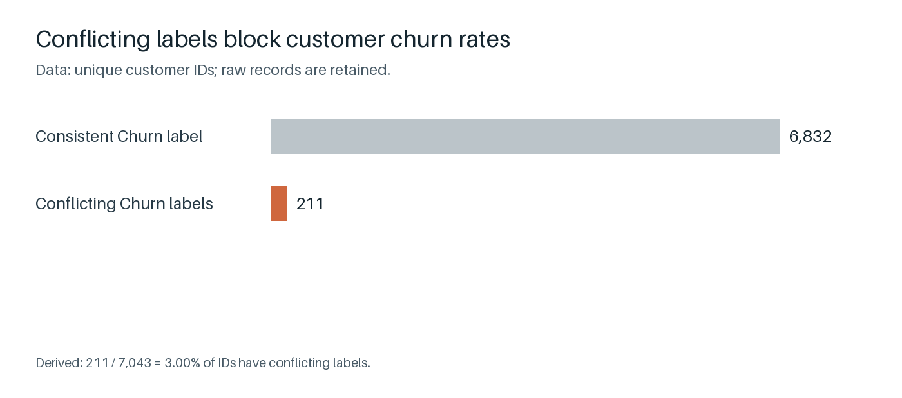
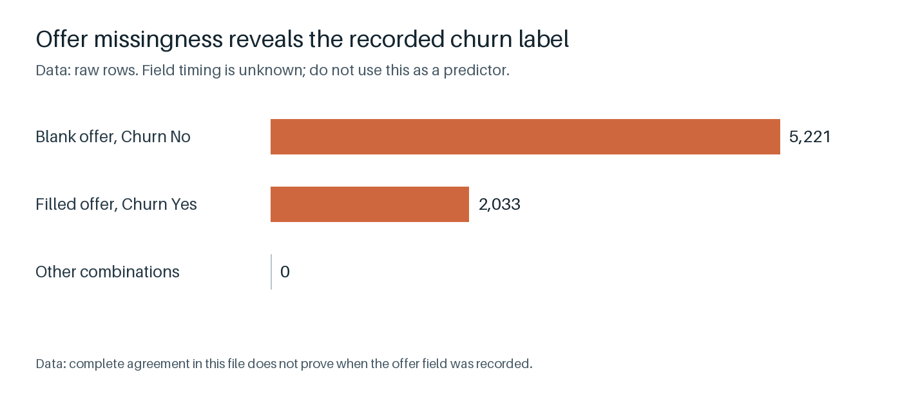

# Campaign funding recommendation

## Summary

**Recommendation: test_first. Pause spending until financial data and customer labels are resolved.**
The current file cannot establish whether the campaign meets the sponsor's profit threshold.
This recommendation does not authorize a pilot launch or full funding.

The source contains **data: 7,254 rows**, **data: 7,043 customer IDs**, and **data: 23 columns**.
**Data: 211 customer IDs** have conflicting churn labels across **data: 422 rows**.
No dated records identify the correct labels. Customer churn rates and driver rankings remain unknown.

The month-to-month category contains **data: 3,875 IDs**, including **data: 102 conflicted IDs**.
This count includes customers recorded as churned. It is not the current eligible campaign population.
The offer field also reveals the recorded churn label through its missingness.

Full funding is **assumption: $2,000,000**, including **assumption: $300,000** for the pilot, both set by the sponsor.
The sponsor requires **assumption: $2,400,000** before that budget over **assumption: 24 months**.
Required net profit is **derived: $2,400,000 - $2,000,000 = $400,000**.
Low, mid, and high profit forecasts are all unknown. Margin, complete costs, and campaign response are unavailable.

There is strong evidence for the data limitations. Confidence in campaign profitability cannot be estimated from this file.
Next, request dated source records and finance inputs. Then approve offer terms and the trial design before spending.

## Charts


Conflicting customer labels prevent a defensible customer churn rate under the repository rule.


The offer field's missingness matches the recorded churn label, so it presents a leakage risk.

## Appendix

### Source, scope, and method
Source: `data/raw/telco_v2.csv` at Git commit `dc208b23c8f539fcdb209ff359a51ab768106e8e`.
Raw Git blob: `e8c695784970d7d5605f85c377369e9a4a8c3724`. `analyze.py` verifies the raw file before and after inspection.
The data reference date, collection method, currency, and coverage are unknown.
Field meanings below are inferred from names unless attributed to `CLAUDE.md`.

Read the source as strings. Inspect numeric fields without changing source cells.
Check identifier consistency before any customer churn calculations. No customer churn model or driver ranking was fitted.
No experimental or campaign performance data exists in the supplied file.
The results are an audit and a decision-readiness assessment.

### Data dictionary and profile
Blank counts include empty strings and whitespace-only values. Numeric ranges exclude blanks only for range calculation.
Types describe parseable nonblank values. They are not an asserted business schema.

| Column | Meaning | Inferred type | Blanks (data) | Minimum (data) | Maximum (data) |
| --- | --- | --- | --- | --- | --- |
| customerID | Customer identifier; one customer per unique ID under CLAUDE.md. | text | 0 | not applicable | not applicable |
| gender | Recorded gender; meaning inferred from field name. | text | 0 | not applicable | not applicable |
| SeniorCitizen | Binary senior status; age rule is unknown. | integer | 0 | 0 | 1 |
| Partner | Partner status; definition is not supplied. | text | 0 | not applicable | not applicable |
| Dependents | Dependent status; definition is not supplied. | text | 0 | not applicable | not applicable |
| tenure | Length of service; time unit is not documented in this repository. | integer | 0 | 0 | 72 |
| PhoneService | Recorded phone service status. | text | 0 | not applicable | not applicable |
| MultipleLines | Recorded multiple-line phone service status. | text | 0 | not applicable | not applicable |
| InternetService | Recorded internet service category. | text | 0 | not applicable | not applicable |
| OnlineSecurity | Recorded online security service status. | text | 0 | not applicable | not applicable |
| OnlineBackup | Recorded backup service status. | text | 0 | not applicable | not applicable |
| DeviceProtection | Recorded device protection service status. | text | 0 | not applicable | not applicable |
| TechSupport | Recorded technical support service status. | text | 0 | not applicable | not applicable |
| StreamingTV | Recorded television streaming service status. | text | 0 | not applicable | not applicable |
| StreamingMovies | Recorded movie streaming service status. | text | 0 | not applicable | not applicable |
| Contract | Recorded contract term; start and renewal dates are unavailable. | text | 0 | not applicable | not applicable |
| PaperlessBilling | Recorded paperless billing status. | text | 0 | not applicable | not applicable |
| PaymentMethod | Recorded payment category. | text | 0 | not applicable | not applicable |
| MonthlyCharges | Recorded monthly charge; currency and billing validity need confirmation. | decimal | 0 | 18.25 | 11,515 |
| TotalCharges | Recorded cumulative charges; currency and coverage need confirmation. | decimal | 11 | 18.8 | 8,684.8 |
| Churn | Yes means left in the last month, per CLAUDE.md; reference month is unknown. | text | 0 | not applicable | not applicable |
| LoyaltyAppUser | Recorded app-use flag; definition and timing are unknown. | text | 0 | not applicable | not applicable |
| RetentionOfferAccepted | Recorded offer-response flag; offer terms and timing are unknown. | text | 5221 | not applicable | not applicable |

### Customer label checks
Counts below preserve every raw record. No conflicting label was selected and no customer was excluded.
All contract values are consistent within each customer ID.

| Contract | Raw rows (data) | Unique IDs (data) | Yes-only IDs (data) | No-only IDs (data) | Conflicting IDs (data) |
| --- | --- | --- | --- | --- | --- |
| Month-to-month | 3977 | 3875 | 1616 | 2157 | 102 |
| One year | 1526 | 1473 | 161 | 1259 | 53 |
| Two year | 1751 | 1695 | 45 | 1594 | 56 |

The conflicting share is **derived: 211 / 7,043 = 3.00%** of unique IDs.
There are **derived: 7,254 - 7,043 = 211** extra ID rows.
There are **data: 0** completely identical extra rows across all columns.
Churn and offer response both differ within every duplicated ID. Other fields agree within those IDs.
The dataset provides no date or source priority to resolve these differences.

Customer churn rates, overall drivers, and within-contract driver directions remain unknown pending an approved resolution rule.
`findings.json` therefore uses an empty drivers list. This does not mean that every variable has no association.

### Missingness and billing checks
The offer-response counts are raw-row diagnostics. They do not measure an offer's treatment effect.

| Offer value | Churn No rows (data) | Churn Yes rows (data) |
| --- | --- | --- |
| [blank] | 5221 | 0 |
| No | 0 | 1457 |
| Yes | 0 | 576 |

All **data: 11** blank total-charge rows have tenure **data: 0**.
These are whitespace values. Their true charge amounts are unknown.

Q1 and Q3 mark the lower and upper quartiles of sorted raw charges.
The charge screen uses **derived: Q1 = 39.1000** and **derived: Q3 = 91.0000** from all raw rows.
The upper fence is **derived: 91.0000 + 3 x (91.0000 - 39.1000) = 246.7000**.
The multiplier is **assumption: 3**, selected by the analyst for a conservative diagnostic screen.
**Data: 200 rows** exceed that fence. Their billing validity is unknown.
Do not divide charges, cap them, or use them as customer profit without source confirmation.

| Issue | Affected rows (data) | Action |
| --- | --- | --- |
| 211 IDs have conflicting Churn labels; no dated resolution exists. | 422 | Retain all rows. Pause customer churn rates and request a source resolution rule. |
| Extreme raw values above the documented quartile screening fence; correctness unknown. | 200 | Flag only. Request billing records and currency confirmation. |
| Whitespace-only blanks; associated tenure values are reported in metrics.json. | 11 | Keep blanks. Do not replace them with zero. |
| Missingness matches Churn exactly across all raw rows; availability timing is unknown. | 7254 | Treat as a leakage risk. Do not use as a pre-outcome predictor or campaign response measure. |
| Required history and financial or experimental fields are absent. | 7254 | Pause spending and financial forecasts. Request the missing inputs. |

These additional screens found the following counts. Category and service rules are analyst checks, pending business confirmation.
A clear screen does not establish overall data quality.

| Screen | Flagged rows (data) |
| --- | --- |
| Blank customer IDs | 0 |
| Churn outside Yes / No | 0 |
| SeniorCitizen outside binary categories | 0 |
| Contract outside observed term vocabulary | 0 |
| Negative tenure or charges | 0 |
| Phone status inconsistent with multiple-line status | 0 |
| Internet status inconsistent with add-on status | 0 |

### Cleaning summary
Rows before inspection: **data: 7,254**. Rows retained: **data: 7,254**.
Removed rows: **data: 0**. Changed source cells: **data: 0**.
No cleaned dataset was produced. `cleaning_log.md` records this decision.
`row_issues.csv` identifies each flagged source line. Several flags can refer to the same row.

### Financial decision and sensitivity
Contribution means revenue less variable service costs. Monthly charges alone cannot establish this amount.
Let N be the eligible population and d be incremental contribution per assigned customer over the sponsor's horizon.
Measure d before campaign-funded incentives, against the no-offer counterfactual.
Let O be additional costs outside the campaign budget B.

- Pre-budget incremental profit = N x d - O.
- Net incremental profit = N x d - O - B.
- Break-even contribution per customer = (B + O) / N, when N is positive.
- Contribution required for the sponsor's buffer = (target + O) / N, when N is positive.

The target is **assumption: $2,400,000**. B is **assumption: $2,000,000**. Both come from the sponsor.
The required buffer is **derived: ($2,400,000 - $2,000,000) / $2,000,000 = 20%**.
Count each incentive cost once. Add back campaign discounts already deducted from contribution before subtracting the all-inclusive budget.
Include the pilot in that budget. Do not add it again when evaluating full-campaign economics.
Confirm the horizon start, payment timing, and cash-payback reconciliation with finance.

| Case | Pre-budget incremental profit | Net profit | Payback | Reason |
| --- | --- | --- | --- | --- |
| Low | unknown | unknown | unknown | Missing margin, costs, eligible population, and causal response |
| Mid | unknown | unknown | unknown | Missing margin, costs, eligible population, and causal response |
| High | unknown | unknown | unknown | Missing margin, costs, eligible population, and causal response |

These unknown entries are not zero-profit estimates. No supported numerical opportunity range is available.
Vary eligible volume, response, margin, renewal, and costs together after their inputs are obtained.
Do not assume annual contracts produce the churn behavior observed among existing annual-contract customers.

### Assumptions and missing inputs
The scenario labels do not imply measured uncertainty bounds. Sponsor constants remain the same across scenarios.

| Input | Low | Mid | High | Label and owner |
| --- | --- | --- | --- | --- |
| Full budget | $2,000,000 | $2,000,000 | $2,000,000 | assumption; sponsor ceiling |
| Pilot ceiling | $300,000 | $300,000 | $300,000 | assumption; sponsor ceiling |
| Profit horizon | 24 months | 24 months | 24 months | assumption; sponsor |
| Pilot time limit | 3 months | 3 months | 3 months | assumption; sponsor |
| Profit buffer | 20% | 20% | 20% | derived from sponsor target: (target - budget) / budget |
| Eligible population | unknown | unknown | unknown | needed; operations |
| Incremental contribution per customer | unknown | unknown | unknown | needed; randomized trial and finance |
| Conversion without an offer | unknown | unknown | unknown | needed; randomized control |
| Renewal and later churn | unknown | unknown | unknown | needed; dated history and trial follow-up |
| Offer and operating costs | unknown | unknown | unknown | needed; finance and operations |
| Additional costs outside budget | unknown | unknown | unknown | needed; finance |
| Forecast horizon start | unknown | unknown | unknown | needed; sponsor |
| Outlier multiplier | 3 | 3 | 3 | assumption; analyst diagnostic screen, not a correction rule |

### Pilot proposal and costs
The analysis team proposes a no-offer control, a convenience message, and an annual-contract credit offer.
Credit amounts, feasibility, allocation shares, and sample size are unknown. Request sponsor approval before launch.
Randomize at customer level and analyze customers as assigned. Keep the no-offer control throughout the pilot.
Use a bandit only if outcome delays and logging permit sound comparisons.
Do not optimize contract sign-ups alone while claiming to optimize profit.
Record assignment probabilities and apply a method suitable for adaptive assignment and repeated reviews.
The pilot time cap is **assumption: 3 months**, set by the sponsor.
Early decisions require an approved rule. At the cap, ask the sponsor if the evidence remains inconclusive.
`pilot_design.md` contains the implementation questions and stopping gates.

| Cost component | Amount | Basis |
| --- | --- | --- |
| Incentives and discounts | unknown | Include all promised incentive costs; count each cost once. |
| Delivery and contact | unknown | Obtain channel quotes. |
| Operations and measurement | unknown | Obtain staffing and tracking costs. |
| Total pilot cost | unknown | Must not exceed 300000; sponsor-set cap. |

No pilot results were supplied. A pilot results table is therefore not available.
The expected results must include each arm's assigned count, response, contribution, costs, follow-up, and uncertainty.

### Required decisions before dependent work
- Request dated records or an approved rule for conflicting customer labels.
- Obtain customer contribution, complete costs, and current eligibility from finance and operations.
- Approve feasible offer terms, sample size, allocation, evidence thresholds, and stopping rules before launch.
- Pause spending while these inputs remain missing. Do not infer approval from this report.

### Reproduction
From the repository root, run:

```sh
python3 -m pip install -r runs/telco/requirements.txt
python3 runs/telco/analyze.py
```

The script creates the report, charts, profile, issue log, contract counts, scenarios, pilot plan, costs, and findings.
It does not write `review.md`. All source counts and displayed financial arithmetic come from this script.
Financial inputs are sponsor assumptions parsed from the brief. No external financial benchmarks were used.
